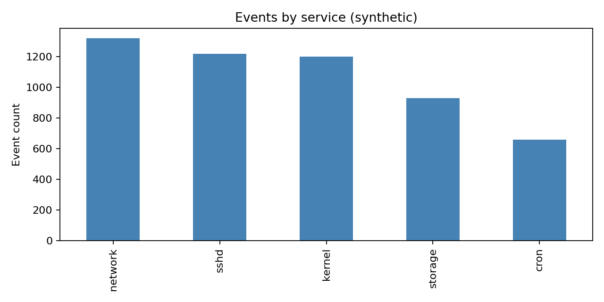
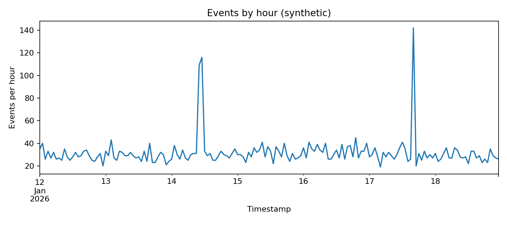
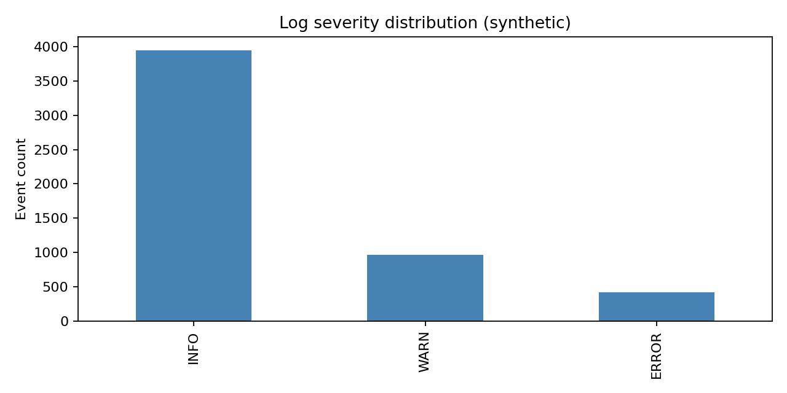
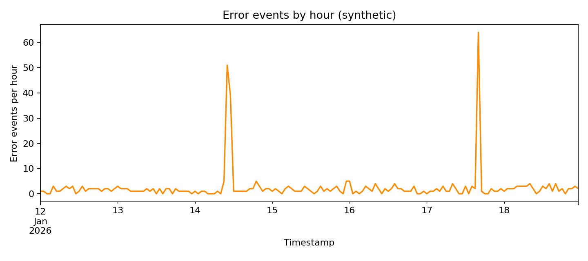
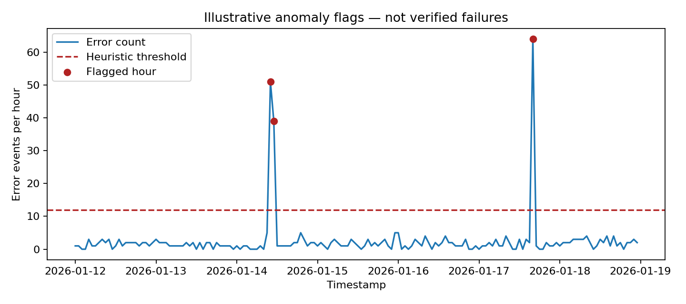

# System Log Analysis: A Model of Concise Technical Reporting

> **Teaching demonstration** — all charts are produced using synthetic records. **No real-system findings are claimed.** Students must replace this example with their own independently analyzed public data.

[Back to repository](../README.md)

## 1. Introduction

**Problem:** Logs provide evidence of activity and possible incidents, but unusual messages do not necessarily indicate confirmed failures.  
**Research questions:** Which services generate the most events? When are errors concentrated? Can a transparent rule highlight inspection candidates?

## 2. Dataset

**For this demonstration:** Artificial data generated by `scripts/make_sample.py` using a fixed seed (42); fields are timestamp, service, level, event, and message. Artificial bursts are introduced by construction.  
**For a final project:** Replace this section with Loghub Linux/OpenStack provenance, selected version and subset, observed time range, parsing approach and known limitations.

## 3. Methodology

Input CSV → validate fields and timestamps → aggregate by service/severity/hour → flag hours with more than **12 ERROR events** → inspect flagged contexts and discuss limitations. The threshold is an illustrative heuristic, not a statistically calibrated failure detector.

## 4. Results

### Figure 1 — Events by service

Compare which services dominate counts. **Interpretation:** volume alone does not indicate reliability.

### Figure 2 — Hourly event counts

Investigate changes in event intensity. In this demonstration, some peaks were artificially inserted.

### Figure 3 — Severity distribution

Compare INFO, WARN, and ERROR event counts, noting that severity conventions vary by system.

### Figure 4 — Error events over time

Examine whether errors cluster during high-activity periods. Correlation does not establish cause.

### Figure 5 — Illustrative anomaly flags

Hours exceeding the stated threshold are investigation candidates—not confirmed incidents.

## 5. Discussion

Explain what counts and event timing suggest about system services, logging, reliability, and error reporting. Address at least: absent ground-truth failures, differences in service logging verbosity, and the arbitrary threshold. **Students should write their own evidence-based interpretation of real data instead of repeating these prompts.**

## 6. Conclusion

Summarize 2–3 findings supported directly by the chosen real dataset. Avoid unsupported claims about root causes or application performance.

## 7. References and reproducibility

- Loghub: https://github.com/logpai/loghub (public-data option for student work)
- Source code and commands: [README](../README.md)
- Generated metrics: [summary.json](figures/summary.json)
- Original dataset URL, release/commit, processing decisions, package versions, and individual contributions **must be documented by student teams**.
